# GPS-Resilient Agricultural Robot Localization and Operator Decision Support

**Team TBD** · UIUC Precision & Digital Agriculture Hackathon, November 2026
Track 3: Automation, Robotics & Intelligent Machines · Challenge 1: Reliable agricultural robot localization using
multimodal sensing

A Python localization backend (EKF sensor fusion, GPS outage experiments, integrity monitoring) and a Streamlit
mission control dashboard with an embedded Rerun replay, built on the public CitrusFarm dataset.

> **Status: research prototype.** This is decision support for a hackathon demo, not a certified autonomous safety
> system. The dashboard never controls a robot. The estimator's 95% uncertainty is **uncalibrated** (see
> [Known limitations](#current-limitations)).

## Contents

1. [Project overview](#project-overview)
2. [Current features](#current-features)
3. [Quick start (Windows)](#installation-and-usage)
4. [Architecture](#architecture)
5. [Dataset and data provenance](#dataset-and-data-provenance)
6. [Sensor fusion implementation](#current-sensor-fusion-implementation)
7. [Rerun integration](#rerun-integration)
8. [Teammate integration guide](#teammate-integration-guide)
9. [Testing](#testing)
10. [Current limitations](#current-limitations)
11. [Demo walkthrough](#two-minute-demo-walkthrough)
12. [Contributing](#contributing)

## Project overview

**The problem.** Orchard robots (sprayers, harvest assist platforms, scouting robots) navigate rows that are only
about 6 m (20 ft) wide. To stay in the row and treat the right trees they need roughly 0.3 m (one foot) of position
accuracy. GPS-RTK delivers centimetres in the open, but a dense citrus canopy can block or reflect satellite signals.
When GPS degrades, a robot that relies on it either stops (lost uptime) or keeps driving on a drifting estimate
(missed or double-sprayed trees, and a real risk to people working nearby).

**Our approach.**

* Fuse wheel odometry, an IMU gyroscope, (when available) LiDAR odometry, and GPS in an Extended Kalman Filter, so the
  robot keeps a usable estimate when GPS drops out.
* Have the robot report **how confident it is**, not just where it thinks it is: the EKF covariance gives a 95%
  position radius, and an integrity monitor turns it into **Trusted / Degraded / Stop recommended**.
* Replay controlled GPS outages on real recorded robot data and measure, against the RTK reference, how fast the error
  grows and whether the warning comes before the error matters.
* Present the result to two audiences:
  * **Farm operators and crew leads**: a simple 3D orchard view, a navigation status, plain-language "what the robot
    can do now", and alerts in English and Spanish.
  * **Engineers**: a Rerun replay and diagnostics (errors, covariance, GPS consistency checks, sensor comparisons).

**Why confidence matters.** A spray decision, a row turn, or slowing down near a crew should depend on whether the
position is currently trustworthy. A robot that knows it is uncertain can slow down, widen its safety buffer, or ask for
a manual check before the error becomes a problem.

## Current features

Everything below runs in the current code and was checked on 2026-11-14 (see [Testing](#testing)). Labels in the UI
(Recorded, Computed, Predicted, Simulated, Illustrative, Uncalibrated) mark the origin of every value.

### Operator dashboard (Mission Control, Operator mode)

| feature | what it shows | data origin |
|---|---|---|
| 3D orchard (Plotly) | trees, robot, trail, uncertainty bubble, crew and safety ring, spray status | trees illustrative, robot computed |
| Robot position and trajectory | EKF estimate at the GPS antenna point | computed from recorded sensors |
| Confidence-coloured trail | trail segments coloured Trusted / Degraded / Stop | computed (integrity monitor) |
| GPS availability and outage replay | GPS Available / Degraded / Lost, outage markers | outage simulated, status computed |
| Localization uncertainty | ± 95% radius tile and gauge, tagged *Uncalibrated* | computed, unvalidated |
| Navigation status | large Trusted / Degraded / Stop recommended banner with reason | computed |
| Robot speed | EKF speed estimate | computed |
| Simulated worker zones | one simulated crew beside the route, dynamic safety buffer | simulated |
| Simulated spraying and tree coverage | treated / missed / double per tree | simulated |
| English and Spanish alerts | crew-facing alerts with an action line | rules on computed state |
| Operator action recommendations | "What the robot can do now" checklist (advisory) | rules on computed state |
| Timeline playback and event jumps | play/pause, time slider, chips that jump to state changes | computed + simulated |
| One-click demo | **Run GPS Failure Demo** (60 s outage at 100 s) and **Reset** | simulated outage |

### Engineer dashboard (Mission Control, Engineer mode)

| feature | where |
|---|---|
| Embedded Rerun web viewer, native Rerun app, `.rrd` download | tab *Rerun replay* |
| RTK reference trajectory and estimated trajectories (all available methods plus a wheel-odometry baseline) | Rerun, tab *Trajectory comparison* |
| Sensor fusion comparisons (C1 / C2 trajectories, B1 baseline) | tab *Trajectory comparison* |
| Localization error vs RTK, 95% uncertainty, coverage | tab *Error vs uncertainty*, tab *Run metrics & provenance* |
| Covariance (`var_x`, `var_y`, `cov_xy`) and uncertainty ellipses | Rerun, 2D map |
| GPS outage intervals, NIS consistency gate, rejected fixes | tab *Sensor fusion & GPS*, tab *Event log* |
| Available sensor diagnostics: gyro bias, odometry scale, wheel vs IMU yaw rate, receiver satellites | tab *Sensor fusion & GPS* |
| Teammate run import and validation report | tab *Team data (adapter)* |
| Integrity thresholds (trusted / stop) | sidebar, Engineer only |

### The five pages (top navigation)

| page | purpose |
|---|---|
| **Mission Control** | the operator and engineer views above, driven by one replay clock |
| **GPS Failure Simulator** | choose outage length and start (and a multipath jump in Engineer mode), replay how the estimate and uncertainty change, compare fallback sensor sets under the identical outage, team batch robustness results |
| **Sensor Cost Comparison** | C1 to C4 sensor sets: qualitative cost tier vs measured drift. Evidence from the team batch tables or a live run on the selected sequence; missing configurations say *Not evaluated* |
| **Orchard Risk Map** | observed receiver quality along the route and a go/no-go check on whether GPS quality varies at all; predicted canopy-to-GPS risk blocks on the labelled synthetic orchard only |
| **Worker Safety** | simulated crews, dynamic buffer `min_buffer + k · r95`, GO / SLOW / STOP light, English and Spanish crew alerts, offline safety scoring against RTK |

Sidebar: user mode (Operator / Engineer), data source, integrity thresholds (Engineer), navigation status key, data
label key.

## Installation and usage

Tested on Windows 11 with Python 3.13. All commands run from the project root.

### 1. Clone and create the environment

```powershell
git clone https://github.com/Phyvlik/team-tbd-uiuc-agrihack-2026.git
cd team-tbd-uiuc-agrihack-2026
py -3.13 -m venv .venv
.venv\Scripts\python -m pip install -r requirements.txt
```

One virtual environment (`.venv`, not committed) serves the backend, the dashboard, the scripts and the tests.

### 2. Get the CitrusFarm subset

The dataset is not in the repository. Download the permitted public subset (no AWS account needed):

```powershell
# gt.csv + odom_*.bag for all 7 sequences + calibration files (about 250 MB)
.venv\Scripts\python scripts\download_citrusfarm_subset.py

# optional: stream 06_14B's base bag (2.5 GB, not stored) and keep IMU + recorded GPS (about 3 MB)
.venv\Scripts\python scripts\extract_base_bag.py 06_14B_Jackal

# build data/processed (reference + odometry) for every sequence
.venv\Scripts\python scripts\validate_baseline.py
```

Details, file meanings and the per-sequence inventory: [`data/README.md`](data/README.md). Without any data the app
still runs on the labelled synthetic orchard.

### 3. Start the dashboard

```powershell
.venv\Scripts\python -m streamlit run app.py
```

Open the URL Streamlit prints (default http://localhost:8501). Pick **06_14B · real · odom + IMU + GPS** in the
sidebar for the recorded-GPS sequence, and switch **User mode** to **Engineer** for the diagnostics and Rerun tab.

### 4. Tests

```powershell
.venv\Scripts\python -m pytest -q
```

### 5. Rerun recordings

From the UI: Engineer mode, Mission Control, tab *Rerun replay*, **Build Engineer recording (.rrd)**, then **Open
embedded web viewer**, **Open native Rerun app**, or **Download .rrd**.

From the command line (defaults: 06_14B, odometry + IMU + GPS, 60 s outage at 100 s):

```powershell
.venv\Scripts\python scripts\export_rerun.py
.venv\Scripts\python scripts\export_rerun.py -h          # other sources, methods, outages, operator view
.venv\Scripts\rerun recordings\engineer_06_14B_Jackal_odom-imu-gps_100s-60s.rrd
```

### 6. Import teammate results

Copy `<SEQUENCE>__<method>.csv` (and optional `.json` sidecar) into `team_runs/`, reload the app, then open Engineer
mode, Mission Control, tab *Team data (adapter)*. Full format in the
[Teammate integration guide](#teammate-integration-guide).

### Other scripts

| script | what it does | writes |
|---|---|---|
| `scripts/run_experiments.py` | batch C1 to C4 comparison and the 10/30/60/120 s outage suite on all processed sequences | `results/*.csv` (tracked) |
| `scripts/calibration_audit.py [SEQ]` | uncertainty calibration audit (measures only, tunes nothing) | `.cache/calibration_audit_<SEQ>.json` |

## Architecture

```mermaid
flowchart LR
    A["CitrusFarm dataset<br/>gt.csv, odom_*.bag, base_*.bag"] ==>|"scripts/download_citrusfarm_subset.py<br/>scripts/extract_base_bag.py"| B["data/raw"]
    B ==>|"scripts/validate_baseline.py"| C["data/processed"]
    B ==> D["src/data_loader.py<br/>SensorStreams"]
    C ==> D
    D ==> E["src/pipeline.py run_experiment<br/>outage_simulator, sensor_fusion (EKF),<br/>reliability_monitor, evaluation"]
    E ==> F["dashboard/backend.py<br/>cached experiments, provenance"]
    T["team_runs/*.csv"] ==>|"dashboard/adapter.py"| F
    E ==>|"scripts/run_experiments.py"| R["results/*.csv<br/>team batch tables"]
    R ==> F
    F ==> G["Streamlit app.py + views/<br/>operator and engineer pages"]
    F ==>|"dashboard/rerun_export.py"| H["recordings/*.rrd"]
    H ==> I["Rerun viewer<br/>embedded iframe or native app"]
```



### Folder structure

```text
app.py                   Streamlit entry point: top navigation, sidebar, theme
dashboard/               UI layer (imports src/, never changes the estimator)
views/                   the five pages
src/                     localization backend (EKF, outages, monitor, evaluation, data loading)
scripts/                 data download/extraction, batch experiments, Rerun export, calibration audit
data/                    CitrusFarm files (not committed; see data/README.md)
results/                 team batch result tables (committed)
team_runs/               drop folder for teammate localization runs
recordings/              generated .rrd files (not committed)
tests/                   pytest suite (backend + UI + Rerun consistency)
docs/                    calibration, provenance, data interface, teammate checklist, demo script
```

### Module responsibilities

| module | responsibility | key functions |
|---|---|---|
| `app.py` | page registry (`st.navigation`, top), sidebar (mode, data source, thresholds, legends) | |
| `dashboard/backend.py` | the only bridge from UI to `src/`: lists data sources, loads streams, runs and caches experiments, reads batch tables, calibration status | `source_keys`, `load_streams`, `methods_for`, `experiment`, `live_config_comparison`, `batch_results`, `reference_caveat` |
| `dashboard/adapter.py` | one `RunBundle` shape for backend runs and teammate CSVs, with unit, time and frame checks | `from_experiment`, `from_csv`, `discover`, `load_team_runs` |
| `dashboard/orchard.py` | illustrative tree rows inferred from the recorded path; simulated spray model | `build_orchard`, `simulate_spray`, `spray_status` |
| `dashboard/ops.py` | operator semantics: GPS status, "what the robot can do now", English/Spanish alerts, timestamped events | `gps_status_series`, `capabilities`, `active_alerts`, `events` |
| `dashboard/scene3d.py` | Plotly 3D orchard with a constant trace layout so playback does not flicker | |
| `dashboard/scenario.py` | cached orchard, spray, demo crew and safety evaluation for a run | `demo_crew`, `safety` |
| `dashboard/opui.py` | toolbar, metric tiles, checklist, alerts, event chips, data label tags, demo buttons | `experiment_toolbar`, `start_demo`, `reset_demo` |
| `dashboard/rerun_export.py` | builds `.rrd` recordings (engineer and operator blueprints), starts the web viewer | `build_recording`, `serve_web`, `open_native` |
| `dashboard/state.py`, `theme.py`, `components.py`, `charts.py` | shared session state, colours, HTML components, Plotly figures | |
| `src/data_loader.py` | the `SensorStreams` contract; reads `gt.csv`, odometry bags, extracted CSVs, processed folders | `build_citrusfarm_sequence`, `load_processed`, `list_processed_sequences` |
| `src/pipeline.py` | one experiment: GPS input, outage scenario, initial pose, EKF, monitor, errors, metrics | `gps_input`, `missing_streams`, `run_experiment` |
| `src/sensor_fusion.py` | 7-state EKF with odometry, IMU, LiDAR odometry and GPS updates, NIS gating | `run_ekf`, `position_radius`, `ellipse_points` |
| `src/outage_simulator.py` | outage windows and multipath jumps applied before the estimator; GPS proxy | `OutageScenario`, `apply_scenario`, `gps_proxy_from_reference`, `standard_outage_suite` |
| `src/reliability_monitor.py` | Trusted / Degraded / Stop from the estimator's own outputs; offline warning scoring | `classify`, `evaluate_warnings`, `transitions` |
| `src/evaluation.py` | error vs reference, summary metrics, outage metrics, coverage | `error_series`, `summary_metrics`, `outage_metrics`, `coverage` |
| `src/sensor_comparison.py` | C1 to C4 configurations, qualitative cost tiers, recommendation | `compare_configs`, `recommend` |
| `src/gps_risk.py`, `src/worker_safety.py` | GPS risk go/no-go and canopy model; dynamic worker buffer and decisions | |
| `src/teammate_import.py` | lower-level trajectory normalisation and frame/unit checks used by the adapter | `guess_time_unit`, `verify` |
| `scripts/export_rerun.py` | command-line `.rrd` export of one scenario | |

**How a page run works.** The sidebar picks a data source. `backend.load_streams` returns a `SensorStreams`. The
toolbar picks a method from `backend.methods_for(streams)` and an outage. `backend.experiment` calls
`src.pipeline.run_experiment` (cached). The page draws the result; the replay slider indexes into it. The Rerun
recording is built from the same result objects.

## Dataset and data provenance

**CitrusFarm** (Teng, Wang, Song and Karydis, UC Riverside, 2023; CC BY-SA 4.0;
https://registry.opendata.aws/citrus-farm/): a Clearpath Jackal driving in citrus orchard blocks 13B, 13D and 14B,
with wheel odometry, IMU, GPS-RTK, LiDAR, cameras and a post-processed RTK reference trajectory (`gt.csv`, measured at
the GPS antenna).

### What is available per sequence (verified 2026-11-14)

| sequence | wheel odometry | RTK reference | IMU | recorded GPS fixes | receiver quality | GPS used in experiments |
|---|---|---|---|---|---|---|
| 01_13B_Jackal | recorded | recorded | no | no | no | **simulated proxy** |
| 02_13B_Jackal | recorded | recorded | no | no | no | **simulated proxy** (EKF tuning sequence) |
| 03_13B_Jackal | recorded | recorded | no | no | no | **simulated proxy** |
| 04_13D_Jackal | recorded | recorded | no | no | no | **simulated proxy** |
| 05_13D_Jackal | recorded | recorded | no | no | no | **simulated proxy** |
| 06_14B_Jackal | recorded | recorded | **recorded** | **recorded** | **recorded** | recorded fixes |
| 07_14B_Jackal | recorded | recorded | no | no | no | **simulated proxy** |

* **Recorded LiDAR and canopy measurements are not connected yet.** No sequence has `lidar_odom.csv` or `canopy.csv`,
  so C3 and the "Full fusion + LiDAR" method show *Not evaluated* on real data.
* **All localization estimates shown come from this project's Python EKF** (`src/sensor_fusion.py`), computed live.
* **No teammate-generated localization runs have been imported yet** (`team_runs/` holds only its README).
* The sidebar label "odom only" means "no extracted IMU/GPS files". Those sequences still run with GPS, using the
  simulated proxy, and the UI says so on the GPS tile.

### Recorded, computed, simulated, illustrative

| label | meaning | examples |
|---|---|---|
| **Recorded** | measured by the robot | odometry, IMU, GPS fixes, receiver state, RTK reference (`gt.csv`) |
| **Computed** | our estimator's output from recorded inputs | EKF position, speed, covariance, 95% radius, integrity state, errors vs RTK |
| **Simulated** | created on purpose to test behaviour | GPS outages, multipath jumps, the GPS proxy, crews, spray, synthetic orchard |
| **Predicted** | model output for places/times not measured | canopy to GPS risk blocks (synthetic orchard only) |
| **Illustrative** | drawn for context, not measured | tree positions inferred from the recorded path |
| **Uncalibrated** | not validated against ground truth | every 95% uncertainty display |

The **simulated GPS proxy** is the RTK reference plus 3 cm white noise at 10 Hz
(`src.outage_simulator.gps_proxy_from_reference`). Errors measured "with GPS" on proxy sequences are therefore not
real-world GPS accuracy. Every displayed metric is traced to its source in
[`docs/METRIC_PROVENANCE.md`](docs/METRIC_PROVENANCE.md).

## Current sensor fusion implementation

### Methods

| method (UI name) | sensors fused | available on |
|---|---|---|
| Odometry + GPS | wheel odometry, GPS | all sequences |
| Odometry + IMU + GPS | wheel odometry, IMU gyro, GPS | 06_14B, synthetic |
| Full fusion + LiDAR | wheel odometry, IMU, LiDAR odometry, GPS | synthetic only (no real LiDAR odometry yet) |
| B1 baseline (Engineer) | wheel odometry only, no GPS after initialisation | all sequences |

The Sensor Cost Comparison uses the plan's configurations C1 (odometry), C2 (+ IMU), C3 (+ LiDAR) and C4 (all with
GPS-RTK); C1 to C3 are the dead-reckoning sets that carry the robot through an outage.

`dashboard/opui.experiment_toolbar` offers only methods whose streams exist (`backend.methods_for`). The default is
Odometry + IMU + GPS; if a sequence cannot support it the toolbar falls back to the last available method.

### The EKF (`src/sensor_fusion.py: run_ekf`)

* **State:** `[x, y, theta, v, w, b_g, k]`: base_link position and heading in the `gt.csv` frame, forward speed, yaw
  rate, IMU gyro bias, and the wheel-odometry speed scale.
* **Prediction:** constant speed and turn rate with random-walk accelerations, bias and scale.
* **Updates**, each with its own noise:
  * wheel odometry `z = [k·v, w]`
  * IMU gyro `z = w + b_g`
  * LiDAR odometry `z = [v, w]`
  * GPS `z = p + R(theta) · lever_arm`
* **Antenna point:** the GPS antenna sits 0.18 m behind base_link (from the official calibration files). The output
  `x_ant, y_ant` is the antenna point, which is what `gt.csv` measures.
* **GPS gate:** each fix is tested with the Normalised Innovation Squared at the 99.9% chi-square level. Rejected fixes
  are logged; after 10 consecutive rejections a fix is accepted to avoid permanent lock-out.
* **No ground truth leakage:** `run_ekf` never receives the reference. The initial pose comes from the first 2 m of the
  GPS track (`src/localization.initial_pose_from_track`).
* **Tuning:** noise values were tuned on 02_13B; the other sequences are held out.

### GPS outages (`src/outage_simulator.py`)

An `OutageScenario` lists `(start_s, duration_s)` windows relative to the sequence start. `apply_scenario` **removes**
GPS fixes inside the windows before the estimator sees them, so withheld readings cannot leak. Multipath jumps add a
2.5 m offset for 4 s (Engineer toggle) to test the consistency gate. The standard suite is 10, 30, 60 and 120 s
outages at several start times.

### Error against the RTK reference (`src/evaluation.py`)

`error_series` interpolates the estimated antenna position onto the reference timestamps and takes the horizontal
Euclidean distance. Summary metrics: mean, RMSE, max, percent of time within 0.3 m, and per-outage peak error, time to
exceed 0.3 m and recovery time. Errors exist only offline (replay), so operators see uncertainty and engineers see
error.

### Uncertainty from the covariance

`position_radius` takes the largest eigenvalue of the 2×2 position covariance and returns
`r95 = sqrt(5.991 · lambda_max)`, a circle that encloses the 95% ellipse (conservative). `coverage` reports how often
the true error is inside `r95`.

### Trusted, Degraded, Stop recommended (`src/reliability_monitor.py: classify`)

Inputs are the estimator's own outputs only (`r95`, time since the last accepted GPS fix, recent GPS rejections):

* **Stop recommended:** `r95 > stop_r95` (default 1.0 m) or GPS and odometry disagreed continuously for 10 s.
* **Degraded:** `r95 > trusted_r95` (default 0.3 m), or no accepted GPS fix for more than 2 s, or a rejection in the
  last 3 s.
* **Trusted:** otherwise.

States escalate immediately and de-escalate after 1 s. Thresholds are editable in Engineer mode and await
confirmation by the domain lead.

### Known calibration limitation

> **The nominal 95% region has not demonstrated 95% coverage.** On 06_14B with recorded GPS it contained the RTK
> reference **53%** of the time. The audit ([`docs/UNCERTAINTY_CALIBRATION.md`](docs/UNCERTAINTY_CALIBRATION.md))
> traces most of this to a 0.19% scale mismatch along the y axis between the recorded GPS conversion and `gt.csv`
> (up to 0.16 m on this route; which side is right is not yet known), plus correlated GPS errors fused as white noise.
> During outages the region is very conservative (median `r95` 6.7 m vs median error 0.29 m with odometry + IMU),
> which is why Stop is recommended about 7.5 s into an outage while the true error stays below 0.3 m for about 29 s.
> Values are displayed exactly as computed and tagged *Uncalibrated*; nothing is rescaled.

## Rerun integration

**Why Rerun.** Engineers need to scrub through time and see trajectories, covariance, GPS checks and filter states
together. Rerun gives a time-synchronised 3D view, time series, and an event log in one viewer, from one file.

**How recordings are made.** `dashboard/rerun_export.build_recording` runs the same backend experiments the page uses
and logs them to `recordings/<kind>_<source>_<method>_<outage>.rrd`. The timeline `time` is seconds since the first
`gt.csv` sample (the Streamlit slider uses the same clock), and positions are metres in the `gt.csv` frame.
`tests/test_consistency.py` reads the `.rrd` back and checks positions, errors and outage times against the Streamlit
values.

**Contents of an engineer recording:**

* `world/reference_rtk`: the RTK reference
* `world/methods/*`: every available method and any imported teammate run
* `world/robot`: robot pose and heading, with `world/trail` (state-coloured) and `world/uncertainty_95` (covariance
  ellipsoid)
* `world/gps/fixes_received`, `world/events/*`: received GPS fixes and outage and event markers
* `world/orchard/*`, `world/crews/*`: illustrative trees with simulated spray colours, and simulated crews when enabled
* plots:
  * `plots/error_vs_rtk/*` and `plots/uncertainty_r95/*` (labelled UNCALIBRATED)
  * `plots/gps/*` (time since fix, receiver quality, NIS accepted and rejected)
  * `plots/fusion/*` (gyro bias, odometry scale, wheel minus IMU yaw rate)
  * `plots/integrity`, `plots/thresholds/*`
* `events`: text log

The **operator recording** keeps only the 3D scene with engineering panels hidden.

**Embedding.** `serve_web` starts the Rerun web viewer server as a local process (ports 9090/9877 engineer, 9091/9878
operator), and the page embeds the viewer in an iframe. **Open native Rerun app** launches the desktop viewer, and the
`.rrd` can be downloaded and opened later with `rerun <file>`.

**What it is not.**

* **Not live streaming:** playback is of a recorded file.
* **Not synchronised with Streamlit:** Rerun has its own cursor. The UI says so and shows the matching `time` value,
  but the Streamlit slider does not move Rerun.
* **No real LiDAR point clouds:** the recording shows "Data unavailable". The adapter accepts a `lidar_points` path in a
  sidecar, but the exporter does not render it yet. Real point clouds need extracted `/velodyne_points` scans (for
  example `.npz` or `.ply` per scan with timestamps) and a small exporter addition.

## Teammate integration guide

This section is the contract for adding your own localization results. The source of truth is
`dashboard/adapter.py` (`from_csv`, `discover`, `load_team_runs`); everything below describes what that code does
today.

### What happens to your file

Imported runs **supplement** the live EKF runs. They never replace them. They appear in:

1. **Mission Control, Engineer mode, tab *Team data (adapter)*:** one summary row per run next to the current EKF run
   (samples, duration, mean and max error, percent within 0.3 m, which optional fields were found), an expander with
   every check and assumption, and an error message for any file that fails to load.
2. **The Engineer Rerun recording:** for runs whose sequence matches the selected source, the trajectory is drawn
   under `world/methods/imported_<method>` and its error under `plots/error_vs_rtk/`.

They do not appear in the operator 3D view, the GPS Failure Simulator, or the Sensor Cost Comparison.

### 1. Where to put files

`team_runs/<SEQUENCE>__<method>.csv` (preferred) or `results/runs/<SEQUENCE>__<method>.csv`. Note the **double
underscore** between sequence and method. Optional sidecar: same name with `.json`. Files are found on every page load;
no code change or restart is needed. `<SEQUENCE>__orchard_geometry.csv` in the same folder is tree geometry, not a run.

### 2. Required columns

| column | meaning | accepted names |
|---|---|---|
| `t` | timestamp of the estimate | `t, time, timestamp, stamp, time_s, time_ns, timestamp_ns` |
| `est_x` | estimated x, metres, `gt.csv` frame | `est_x, x_est, estimated_x, x_hat` |
| `est_y` | estimated y | `est_y, y_est, estimated_y, y_hat` |

Column names are matched case-insensitively after replacing non-alphanumerics with `_`. **Bare `x` and `y` are not
accepted**, because a column called `x` could be the reference. A missing required column raises an error shown in the
Team data tab.

### 3. Optional columns

| column(s) | unit | accepted names | used for |
|---|---|---|---|
| `ref_x, ref_y` | m | `ref_x, gt_x, rtk_x, reference_x` (and `_y`) | your own reference; otherwise the sequence's recorded `gt.csv` is interpolated |
| `var_x, var_y, cov_xy` | m² | `var_x, cov_xx, p_xx`, `var_y, cov_yy, p_yy`, `cov_xy, p_xy` | covariance; r95 is derived from it |
| `r95` | m | `r95, radius_95, uncertainty_95_m` | 95% radius if you have no covariance |
| `speed` | m/s | `speed, v, vel` | display |
| `heading` | rad, counterclockwise from +x in the gt frame | `heading, theta, yaw` | display; required for base_link estimates |
| `gps_available` | 0/1 | `gps_available, gps_ok` | was a fix used at this step |
| `gps_rejected` | 0/1 | `gps_rejected, rejected` | fix rejected by your filter |
| `gps_quality` | any numeric | `gps_quality, num_sat, h_sigma_m` | receiver quality |
| `gyro_bias` | rad/s | `gyro_bias, b_g, bias_gz` | filter state |
| `outage` | 0/1 | `outage` | marks samples inside a GPS outage |
| `sequence_id`, `method` | text | `sequence_id, sequence, seq`, `method, sensor_config, config` | identification (see 7 and 8) |

Lines starting with `#` are ignored, so you can put a comment header in the file.

### 4. Timestamps and units

* Time units: `s`, `ms`, `us`, `ns`. If the sidecar sets `"time_unit"`, that is used. Otherwise the unit is guessed
  from the magnitude of the values (an epoch in ns, us or ms is detected; anything smaller is treated as seconds).
* **Relative timestamps in ms/us/ns need `"time_unit"` in the sidecar**, because the magnitude check only recognises
  epoch-sized values.
* Epoch timestamps (median above 1e8 s) are converted to seconds since the sequence start when the sequence is known.
  CitrusFarm sequences use Unix epoch ROS header stamps, so exporting header stamps is the safest choice. Use the time
  the measurement was taken, not the bag receive time.
* Small values are assumed to already be seconds since the sequence start (the first `gt.csv` sample).
* The checks report the time overlap with the sequence as a percentage.

### 5. Coordinate frame and position units

* Positions must be in the **`gt.csv` frame**: ENU rotated by -90 degrees, so **x points north, y points west**, origin
  at the first `gt.csv` sample, metres.
* The point: by default estimates are assumed to describe the **GPS antenna** (what `gt.csv` measures). If yours
  describe base_link, set `"point": "base_link"` in the sidecar **and** include `heading`. The adapter then applies the
  0.18 m lever arm. Without heading it reports an uncorrected bias of up to 0.18 m.
* Length units: `m` (default), `cm`, `mm`, `ft` via `"length_unit"`. Covariance is scaled by the square of the factor.
* After alignment the adapter runs `src.teammate_import.verify`, which flags:
  * a start offset above 0.5 m (missing initial alignment)
  * a rigid rotation above 10 degrees that removes most of the error (frame or heading mismatch, for example a missing
    -90 degree rotation)
  * a path length more than 5% off the reference (speed scale or unit error)
  * non-monotonic timestamps

### 6. Sequence naming

Use the exact dataset names: `01_13B_Jackal` to `07_14B_Jackal`. The sequence is taken from the first available of:
sidecar `sequence_id`, a `sequence_id` column, or the file name before `__`. A run for a sequence the app does not know
still loads, but time alignment and error are only possible if it contains `ref_x, ref_y`.

### 7. Method and sensor naming

The method name comes from the sidecar `method`, a `method` column, or the file name after `__`. Use short, descriptive
names, for example `ekf-odom-imu-lidar`, `odom-slip-corrected`, `lio-sam`. Put the sensors actually used in the
sidecar `"sensors"` field (for example `"odom+imu+lidar+gps"`) and say whether GPS was recorded or simulated with
`"gps_input": "recorded"` or `"gps_input": "proxy"`.

### 8. GPS outage metadata

Either a sidecar `"outages_s": [[start_s, end_s], ...]` in seconds since the sequence start, or an `outage` column of
0/1 per sample (the adapter converts runs of 1s into intervals). To compare with our runs, use the same windows (the
dashboard demo uses a 60 s outage starting at 100 s).

### 9. Covariance and uncertainty

Give `var_x, var_y, cov_xy` for the antenna position in m² if your filter has them. The adapter computes
`r95 = sqrt(5.991 · lambda_max)` exactly like the backend. Otherwise give `r95` directly. Negative variances are
flagged. If you have neither, uncertainty is reported as *Not evaluated*.

### 10. Missing data

Missing optional columns stay empty. The adapter **never infers** a field from another field (no speed from
positions, no covariance from error), and the UI shows *Not evaluated* for it.

### 11. Example (synthetic values, format only)

[`docs/examples/06_14B_Jackal__example-synthetic.csv`](docs/examples/06_14B_Jackal__example-synthetic.csv):

```csv
# SYNTHETIC EXAMPLE: made-up values that show the file format only. Not a localization result.
t,est_x,est_y,var_x,var_y,cov_xy,speed,heading,gps_available,gps_rejected,outage
0.0,0.000,0.000,0.0025,0.0025,0.0000,0.00,0.000,1,0,0
0.5,0.250,0.010,0.0025,0.0026,0.0001,0.50,0.040,1,0,0
1.0,0.500,0.020,0.0026,0.0027,0.0001,0.50,0.040,1,0,0
1.5,0.750,0.030,0.0090,0.0110,0.0004,0.50,0.040,0,0,1
2.0,1.000,0.040,0.0200,0.0250,0.0008,0.50,0.040,0,0,1
2.5,1.250,0.050,0.0026,0.0027,0.0001,0.50,0.040,1,0,0
```

Sidecar `06_14B_Jackal__example-synthetic.json`:

```json
{
  "sequence_id": "06_14B_Jackal",
  "method": "example-synthetic",
  "sensors": "odom+imu+gps",
  "gps_input": "recorded",
  "point": "antenna",
  "time_unit": "s",
  "length_unit": "m",
  "outages_s": [[1.5, 2.0]]
}
```

To see how a file is handled, copy both files into `team_runs/` and open the Team data tab. Delete them afterwards so
the example is not mistaken for a result. `tests/test_app.py::test_documented_example_run_imports` checks this example.

### 12. Validate quickly in Python

```python
from dashboard import adapter as ad
b = ad.from_csv("team_runs/06_14B_Jackal__my-method.csv")
print(b.summary())
print("\n".join(b.checks))
```

### 13. Adding a new localization method

* **Your own algorithm (recommended):** run it on the sequence, export a CSV as above, and drop it in `team_runs/`. This
  needs no code change.
* **A new sensor combination of our EKF:** add an entry to `METHODS` and `METHOD_LABEL` in `dashboard/backend.py` (a
  tuple of `odom`, `imu`, `lidar`, `gps`). It appears in the toolbar for sequences that have those streams.
* **A new estimator inside the backend:** add it under `src/` with the same output columns as `run_ekf`
  (`t, x_ant, y_ant, theta, v, r95, var_x, var_y, cov_xy, time_since_gps, gps_rejected`, ...) and call it from
  `src/pipeline.run_experiment`. This changes scientific behaviour, so discuss it with the fusion owner first.

### 14. Wheel odometry vs corrected odometry

* **What exists today:**
  * The B1 baseline integrates raw wheel odometry; the Engineer *Trajectory comparison* tab shows it next to the fused
    runs.
  * The EKF estimates an odometry speed scale `k` online (`plots/fusion/odom_speed_scale_k` in Rerun).
  * `scripts/validate_baseline.py` reports scale-calibrated variants.
* **To compare a slip-corrected odometry trajectory:** dead-reckon it, export it as `<SEQ>__odom-slip-corrected.csv`
  with `gps_input` omitted and `sensors` set to `"odom"`, and compare its error in the Team data tab and Rerun against
  the B1 baseline.
* **Fusing a corrected odometry twist inside our EKF is not implemented.** The odometry stream is fixed to `odom.csv`
  (`t, v, w`). It would need a new stream in `SensorStreams` and a measurement update in `run_ekf`. Please do not
  overwrite `odom.csv` with corrected values, because that silently changes every experiment.

### 15. LiDAR and other sensor outputs

* **LiDAR odometry for the EKF:** write `data/raw/<SEQ>/lidar_odom.csv` with `t, v, w` (s epoch, m/s, rad/s, body
  frame). `src.data_loader.build_citrusfarm_sequence` loads it, which unlocks C3 everywhere. On a sequence with IMU it
  also unlocks the "Full fusion + LiDAR" method. Re-run `scripts/run_experiments.py` to refresh the batch tables.
* **Receiver quality:** `data/raw/<SEQ>/gps_quality.csv` (`t` plus numeric metrics, optional `x, y`) enables the Orchard
  Risk Map for that sequence.
* **Canopy index:** `data/raw/<SEQ>/canopy.csv` (`t, ndvi`, optional `x, y`) enables the canopy model on real data.
* **Tree geometry:** `team_runs/<SEQ>__orchard_geometry.csv` (`x, y[, row]`, gt frame) replaces the illustrative trees.
* **Point clouds:** not rendered yet (see [Rerun integration](#rerun-integration)).
* The stream contract (columns, units, frames) is in [`docs/DATA_INTERFACE.md`](docs/DATA_INTERFACE.md). Any extracted
  CSV in `data/raw/<SEQ>/` makes that sequence load from raw files instead of `data/processed/`.

### 16. Before you send results

* **No ground truth as input:** do not feed `gt.csv` into your estimator, and do not smooth with future data.
* **Tune and test on different sequences:** tune on 02_13B only, report on the others.
* **Send numbers, not plots:** numeric CSVs, never plot images.
* **Check the Team data tab:** look for red flags (start offset, rotation, path length ratio, time overlap) before
  quoting a number.
* **Export checklist:** see [`docs/TEAMMATE_DATA_REQUESTS.md`](docs/TEAMMATE_DATA_REQUESTS.md) for the short version
  and for the open data requests.

## Testing

`.venv\Scripts\python -m pytest -q` runs:

* `tests/test_core.py`: backend unit tests (EKF, outages, monitor, evaluation, import checks).
* `tests/test_app.py`: headless Streamlit `AppTest` of all five pages in both modes, plus several guards:
  * provenance labels
  * that the EKF covariance is not rescaled
  * that `src/` and `data/` resolve inside the project
  * adapter imports, including the documented example
* `tests/test_consistency.py`: exports `.rrd` files, reads them back, and checks that Rerun and the operator 3D scene
  agree on coordinates, units and timestamps.

Most UI tests need the local CitrusFarm data for 06_14B (see step 2 of the installation).

## Current limitations

* **Uncertainty is uncalibrated** (53% coverage of the nominal 95% region on 06_14B with recorded GPS). The 0.19% frame
  scale question must be resolved and the audit re-run on more sequences before the bubble can be trusted.
* **Only 06_14B has recorded IMU and GPS.** The other six sequences use a simulated GPS proxy; C2 is measured live on
  06_14B only, and the committed batch tables predate the 06_14B extraction.
* **No real LiDAR odometry, point clouds or canopy index** are connected; C3 is *Not evaluated* on real data.
* **Teammate localization estimates are not integrated yet**; the adapter and drop folder are ready.
* **The proposed wheel-slip correction is not investigated in the fusion yet** (see 14 above).
* **Navigation thresholds** (0.3 m trusted, 1.0 m stop, 2.0 m minimum worker buffer) await domain lead review. With
  odometry + IMU the monitor recommends Stop far earlier than the true error requires.
* **Rerun and Streamlit playback are independent**; there is no supported cursor sync for the embedded web viewer.
* **Agricultural scenarios are illustrative:** tree rows, spray coverage and crews are simulated or inferred and are
  not measured agricultural performance. Spanish alert text needs review by a native speaker.

## Two-minute demo walkthrough

Full script with what to say and which claims to avoid: [`docs/DEMO_SCRIPT.md`](docs/DEMO_SCRIPT.md).

1. **Mission Control, Operator, 06_14B.** A real CitrusFarm run; the trees are drawn for context.
2. **Run GPS Failure Demo.** GPS is cut for 60 s at 100 s: GPS tile goes Lost, status turns Degraded, the bubble and
   the crew safety ring grow, and the checklist and English/Spanish alerts update.
3. **Stop recommended** appears a few seconds into the outage; the event chip jumps back to it.
4. **GPS restored:** status returns to Trusted; pale trees show what a drifting sprayer would have missed (simulated).
5. **Engineer mode, tab *Rerun replay*:** build the recording, open the embedded viewer, scrub the same event.
6. **Sensor Cost Comparison:** wheel odometry alone vs adding a low-cost IMU under the same outage; LiDAR *Not
   evaluated*.
7. **Orchard Risk Map:** on this route the receiver kept RTK the whole time, and we say so.

No screenshots are committed yet; run the app to see the views.

## Contributing

* Work on a branch, use Conventional Commits (`type(scope): imperative subject`), keep commits small. See
  [`CLAUDE.md`](CLAUDE.md) / [`AGENTS.md`](AGENTS.md) for the full conventions.
* Run `pytest` before pushing. Never force-push to `main`.
* Never commit `data/raw`, `data/processed`, `.bag` files, `.rrd` recordings or virtual environments.
* Label every new number as recorded, computed, simulated, predicted or illustrative, and never present simulated or
  proxy results as real-world performance.

Data: CitrusFarm (Teng, Wang, Song and Karydis, UC Riverside, 2023), CC BY-SA 4.0.
